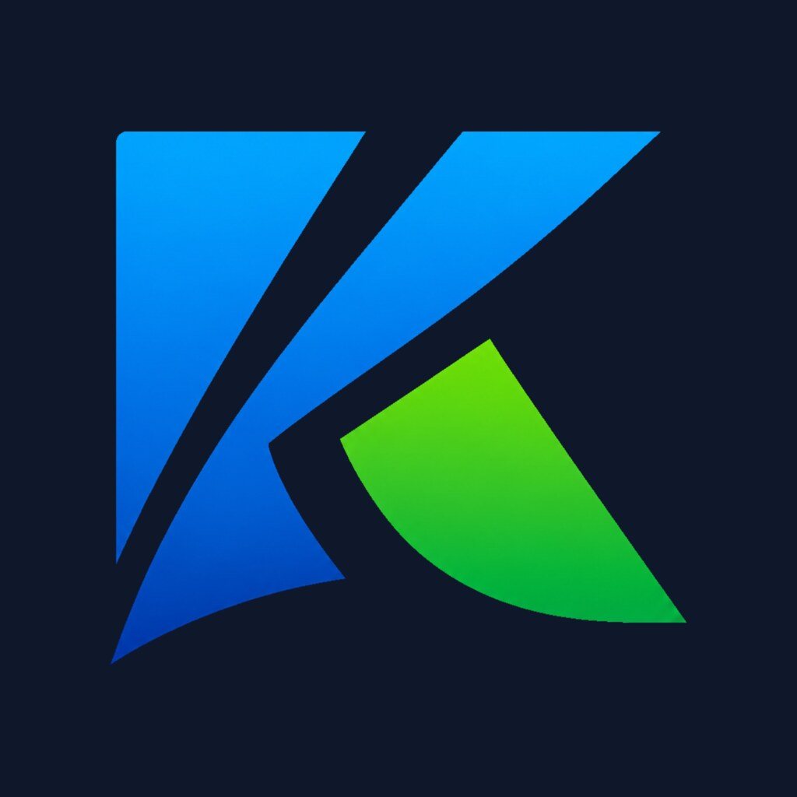

<p align="center">
  
</p>

# Kiro Google Drive

Mount a shared Google Drive folder in your home folder: paste the share link, sign in once, and the folder shows
up under `~/GoogleDrive/<name>`. It mounts again by itself every time you log in.

Kiro Google Drive is a small GTK4 app with a matching command-line interface. Under the hood it drives
[rclone](https://rclone.org/) and a systemd user service, so nothing runs as root and nothing touches your own
rclone setup.

## What it does

- **Paste a link, get a folder.** Accepts `drive.google.com/drive/folders/...` links, `open?id=...` links or a bare
  folder ID. The share is named after the folder's own Drive name unless you pick a name.
- **Read-only, on purpose.** It asks Google only for read access (`drive.readonly`) and mounts with `--read-only`.
  You can open and copy everything; nothing on Drive can be changed or deleted from here.
- **Mount at login.** Each share is a `kiro-gdrive@<name>.service` systemd user unit. Turn "At login" off to mount
  it only when you want.
- **Sign out cleanly.** Signing out unmounts every share, deletes the stored token and revokes it at Google.

Only folders can be mounted, not single files. The Google account you sign in with must be able to open the link,
which holds for any "Anyone with the link" share.

## Installation

Add the nemesis_repo to `/etc/pacman.conf`:

```ini
[nemesis_repo]
SigLevel = Never
Server = https://erikdubois.github.io/$repo/$arch
```

Then install:

```bash
sudo pacman -S kiro-gdrive
```

## Using it

Open **Kiro Google Drive** from your menu, click **Sign in with Google**, paste a folder link and click
**Add and mount**.

From a terminal (`kgd` is a short alias for `kiro-gdrive`):

```bash
kgd login                                   # opens Google sign-in in your browser
kgd add https://drive.google.com/drive/folders/FOLDER_ID
kgd list                                    # shares, mount state, at-login state
kgd unmount NAME / kgd mount NAME
kgd disable NAME / kgd enable NAME          # stop / start mounting at login
kgd remove NAME                             # unmount and forget (Drive is untouched)
kgd logout                                  # remove all shares and revoke the token
```

### On a machine without a browser

Sign-in needs a browser on the same machine, because Google sends you back to `http://127.0.0.1:53682/`. Over SSH,
forward that port and sign in from your own desktop:

```bash
ssh -L 53682:127.0.0.1:53682 user@remote-machine
kgd login --no-browser                      # then open the printed link on your desktop
```

## Where things live

| What                       | Path                                           |
|----------------------------|------------------------------------------------|
| Mount points               | `~/GoogleDrive/<name>`                         |
| rclone config (private)    | `~/.config/kiro-gdrive/rclone.conf`            |
| Google token               | `~/.config/kiro-gdrive/token.json` (mode 0600) |
| Your own OAuth client      | `~/.config/kiro-gdrive/client.json` (optional) |
| Logs                       | `journalctl --user -u kiro-gdrive@<name>`      |

To use your own Google OAuth client instead of the shipped one, put
`{"client_id": "...", "client_secret": "..."}` in `~/.config/kiro-gdrive/client.json` and sign in again.

## Requirements

- `rclone` and `fuse3`
- GTK4 + PyGObject (`python-gobject`) for the window; the CLI works without a display

## Running from the source tree

```bash
python3 usr/share/kiro-gdrive/kiro-gdrive.py            # window
python3 usr/share/kiro-gdrive/kiro-gdrive.py status     # CLI
```

The mount unit must be installed for mounting to work. From a checkout, link it into
`~/.config/systemd/user/` and run `systemctl --user daemon-reload`.

## License

GPL-3.0 — see [LICENSE](LICENSE)
